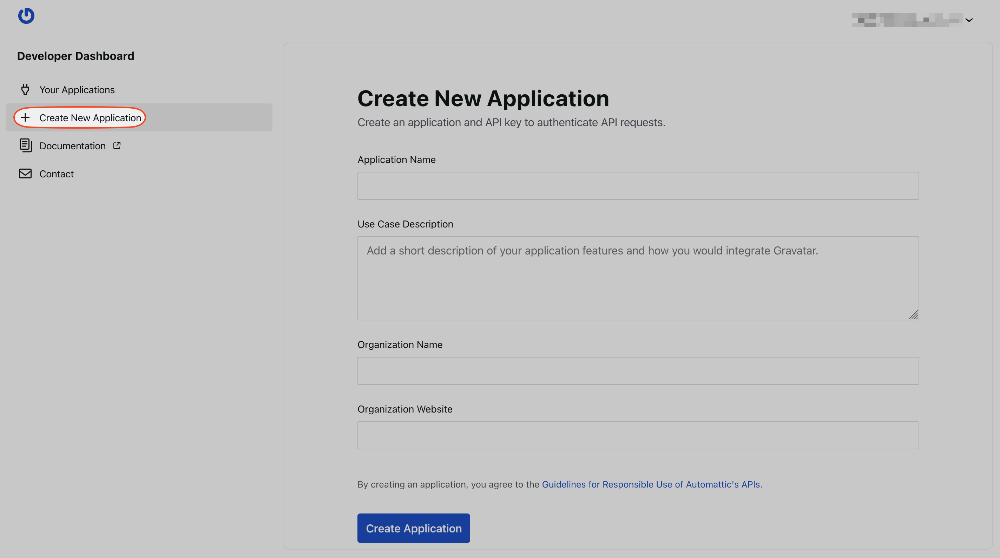

# Get Started with Gravatar-SDK-Android

## Creating an API key

You'll need an API key to use the SDK's full capabilities. You can use some features without an API Key, but you'll receive limited information, and stricter rate limits may apply, so we highly encourage you to create one in the [developers' portal](https://gravatar.com/developers/). 

You can create the API Key as follows:

1. Login in to your Gravatar account (or the Gravatar account you want to use to generate the key)
2. Navigate to the [developers portal](https://gravatar.com/developers/)
3. Tap on [`Create new Application`](https://gravatar.com/developers/new-application)
4. Fill the required data and follow the flow



5. You'll get your Gravatar API Key. Save it in a safe place!

## Installation

First step is to add the maven repositories to the file where you manage your the dependency resolution and the right dependencies to the `build.gradle` file:

### Add the Gravatar dependencies to your project

```kotlin
dependencies {
    implementation("com.gravatar:gravatar:<version>")
    implementation("com.gravatar:gravatar-ui:<version>")
    implementation("com.gravatar:gravatar-quickeditor:<version>")
}
```

Additionally, if you're using version 2.3.1 or older of the SDK, you need to add custom Gradle repository:

```kotlin
repositories {
    maven {
        url = uri("https://a8c-libs.s3.amazonaws.com/android")
    }
}
```

### Store the Gravatar API key in your app

There are many ways to store the Gravatar API key in your app. The best way to do this depends on your app's architecture and requirements and how you're already storing other sensitive information. Make sure to avoid hardcoding the API key in your app's code and make sure to avoid storing it in a public repository.

One way to store the API key in your app is by adding it to the `local.properties` file:

```properties
gravatar.api.key = REPLACE_ME
```

Then update your gradle file to read the API key from the `local.properties` file and put it in the generated `BuildConfig` class:

```kotlin
android {
    buildFeatures.buildConfig = true

    defaultConfig {
        val properties = Properties()
        properties.load(FileInputStream(project.rootProject.file("local.properties")))
        buildConfigField("String", "GRAVATAR_API_KEY", "\"${properties["gravatar.api.key"]}\"")
    }
}
```

Then you can access the API key in your app's code like this:

```kotlin
Gravatar.apiKey(BuildConfig.GRAVATAR_API_KEY)
    .appIdentifier("your-app", BuildConfig.VERSION_NAME) // Optional but highly encouraged.
```

`appIdentifier` names your app in the `X-Source` header and the `User-Agent` of every SDK request,
including the avatar images the UI components load, so your traffic can be attributed and
allowlisted server-side. Use the identifier your backend already knows you by, and keep it stable
across releases and build types — one rule then covers you everywhere.

The name has to be a `User-Agent` product token, so it cannot hold whitespace, `/`, `(`, `)` or `;`
and has to be unaccented ASCII — `wp-android` is fine, `My App` is not. Anything else throws
`IllegalArgumentException` right at the call, naming the token it would have made, rather than
failing your requests later. The version is freer, and may hold spaces: `27.6 (hotfix)` is fine.

`Gravatar.userAgent` and `Gravatar.appName` expose what the SDK sends, if you want to reuse them on
requests you make yourself.

If you have no such identifier, `Gravatar.context(appContext)` derives the name and version from the
package instead:

```kotlin
Gravatar.apiKey(BuildConfig.GRAVATAR_API_KEY)
    .context(appContext)
```

That is weaker, because the launcher label is localized and build types usually suffix it, so the
same app reaches the backend under several names. A label is reduced to a product token before it
is sent, so `Jetpack (Debug)` arrives as `Jetpack-Debug`, and a label with nothing a token can hold
— one written entirely in kana, say — is not sent at all. Calling both is fine in any order: `appIdentifier`
wins and the `context` call is ignored. Set whichever you use once and early — `Application.onCreate`
is the natural place — since it has to run before the first request.

# Usage

The Gravatar SDK is separated into three modules: [`:gravatar`](#REST-API-Services), [`:gravatar-ui`](#UI-components) and [`:gravatar-quickeditor`](#Quick-Editor). They can be used all together or you can pick the one that suits your needs.
Below you can find description of how to use each module.

## Core Module

The :gravatar module provides convenience classes to interact with Gravatar’s public [REST API](https://docs.gravatar.com/api/), enabling easy access to user profiles and avatars.

For details on how to use the `:gravatar` module, see [Core Module Usage](usage-core.md).

## UI Module

The :gravatar-ui module provides customizable Jetpack Compose components, such as profile cards of various sizes and layouts, for displaying Gravatar user information in your app.

For details on how to use the `:gravatar-ui` module, see [UI Module Usage](usage-ui.md).

## Quick Editor

The :gravatar-quickeditor module simplifies avatar management by offering a fully featured, customizable UI for editing avatars directly within your app. 

It supports OAuth authentication with built-in flow handling or token-based integration, provides flexible options for Jetpack Compose and traditional Views, and includes features like secure token storage, cache-busting for immediate updates, and easy theming. Designed to improve user experience and make development straightforward, it requires minimal configuration while adhering to modern Android practices.

For details on how to use the `:gravatar-quickeditor` module, see [Quick Editor Module Usage](usage-quickeditor.md).
